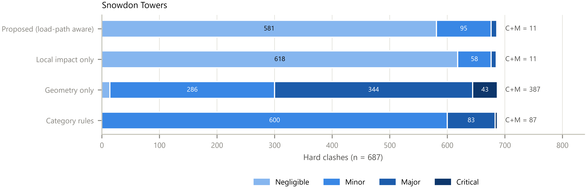
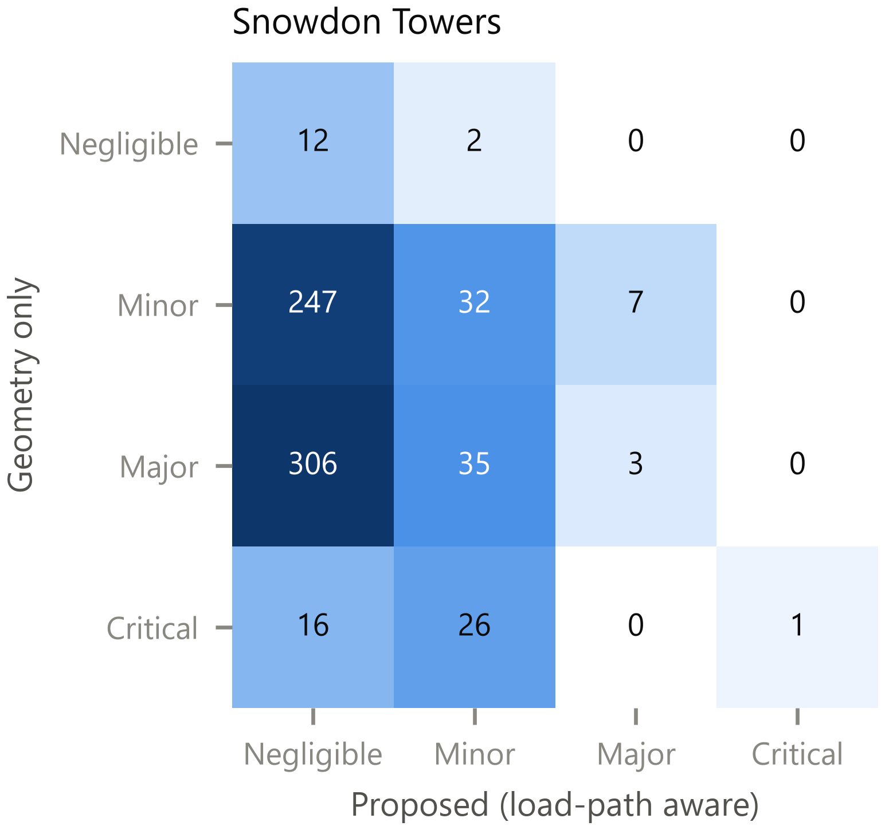
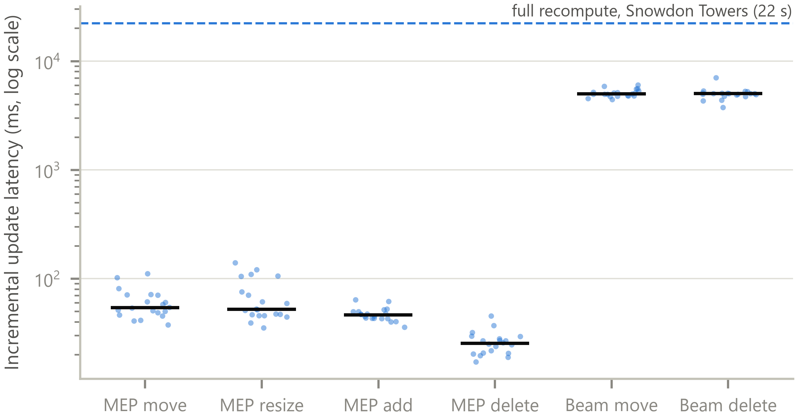

# Abstract {.unnumbered}

<!--ABSTRACT-->

**Keywords:** Building information modelling; Clash detection; Digital twin; Load path; Severity classification; Revit API; Structural robustness

# Introduction

Clash detection is one of the most widely used building information modelling (BIM) workflows. Federated discipline models are checked geometrically and every interference between, for example, a duct and a beam is reported for resolution before construction. The economic case is well documented: unresolved design clashes that surface on site lead to rework, delay and cost [@chahrour2020], and coordination problems remain frequent because disciplines model in isolation [@akponeware2017]. Yet the output of commercial clash engines is notoriously noisy. Thousands of interferences are reported for a single building, and a large share of them are irrelevant, duplicates of one design issue, or resolvable later without consequence [@hu2019; @lin2019]. Coordinators therefore spend much of their time triaging reports rather than resolving problems [@borkowski2026; @koo2026].

The research response has concentrated on *relevance*: learning, from historical coordination decisions, which clashes a human coordinator would discard [@hu2019; @lin2019; @ailem2026; @koo2026], or ranking clashes with expert-weighted attributes of the elements involved [@bitaraf2024]. These approaches reproduce coordinator judgement, but they do not reason about what a clash does to the structure. For structural members this is the question that matters. A 100 mm pipe through the web of a girder near its support, through the tension zone of a beam at mid-span, or through a slab within the punching-shear perimeter of a column can be far more serious than a much larger duct that merely grazes a non-load-bearing element. Two clashes with identical geometry can also have very different consequences, depending on how much of the building depends on the member that is cut. That dependency is a property of the structure's *load path*, which is not represented in any clash report.

At the same time, BIM practice is moving from periodic, file-based coordination toward *digital twins*: continuously synchronised virtual representations that are updated as the design or the asset changes [@grieves2016; @boje2020; @sacks2020; @opoku2021]. In a twin, clash checking should not be a batch job run once a week. It should be an incremental service that re-evaluates only what changed and pushes its assessment back to the authoring environment. Most clash-management research, however, still assumes a static export to a separate tool.

This paper addresses both gaps with a framework that (i) extracts structural and MEP elements, their geometry and their connectivity directly from Autodesk Revit through its application programming interface (API) using Python; (ii) detects hard, touch and clearance clashes with exact mesh geometry; (iii) builds a gravity *load-path graph* of the structure and derives, for every member, the load that depends on it and the load that has no alternative path if it fails; (iv) classifies each clash by combining a code-informed estimate of the *local* capacity loss with this *global* load-path consequence; and (v) keeps all of this synchronised with the authoring model as a digital twin that processes Revit change events incrementally and writes its results back into Revit. The specific contributions are:

1. A load-path graph built automatically from BIM geometry and Revit connectivity, with load propagation by tributary areas, exact equilibrium, and a dominator-tree measure of *orphaned load* that operationalises the alternate-load-path concept used in progressive-collapse design [@ufc2016; @starossek2010].
2. A two-axis severity model, a demand-weighted capacity loss index (local) combined with a load-path consequence expressed in bay-equivalents (global), that is transparent, member-type specific and adapted from design provisions for openings in concrete and steel members [@aci2019; @darwin1990].
3. A digital-twin synchronisation layer with fingerprint-based change detection and incremental clash, load-path and severity updates that are provably identical to full recomputation, closed through a pyRevit hook and a write-back command.
4. An open, reproducible evaluation on two federated Revit models: detection accuracy against Revit's own solid-intersection filter, load-path equilibrium, comparison with geometry-only and category-based triage, a one-at-a-time sensitivity analysis, and twin latency.

The remainder of the paper is organised as follows. Section 2 reviews related work. Section 3 presents the framework. Section 4 describes the implementation, the case-study models and the evaluation design. Section 5 reports the results, Section 6 discusses implications and limitations, and Section 7 concludes.

# Related work

## Automated clash detection and relevance filtering

Clash detection engines compare element geometry pairwise after a spatial pre-selection. Bounding-volume hierarchies of axis-aligned [@bergen1997] or oriented [@gottschalk1996] boxes and spatial indexes such as the R-tree [@guttman1984] keep the number of exact tests manageable, and general-purpose libraries such as FCL provide collision, distance and proximity queries on triangle meshes [@pan2012]. In practice the bottleneck is not computation but interpretation. Hu and Castro-Lacouture trained supervised classifiers to separate relevant from irrelevant clashes using attributes of the clashing components [@hu2019], and later exploited dependencies between components and between clashes to improve detection holistically and to optimise correction sequences [@hu2019b; @hu2020; @hu2021]. Lin and Huang combined expert rules with supervised learning to filter irrelevant clashes [@lin2019]. More recent work packages relevance filtering as a plug-in within the BIM environment [@ailem2026], introduces risk and relevance analysis aligned with how coordinators work [@koo2026], proposes AI-based triage that also groups recurring clashes [@borkowski2026], and prioritises structure–MEP hard clashes with expert-weighted criteria derived by the Best–Worst Method [@bitaraf2024]. Knowledge-based [@hsu2020; @wang2016] and learning-based [@liu2020] approaches have also been proposed to support clash *resolution*, and recent work links MEP–structural coordination to on-site execution through path planning and augmented reality [@xu2025].

These studies share two characteristics. Severity or relevance is inferred from element *attributes* (type, discipline, size, location) or learned from past decisions, and the structural role of the clashing member is at most a categorical feature. None of them, to the authors' knowledge, evaluates how much capacity a penetration removes at its position along the member, or how much of the building depends on that member.

## Rule-based checking and structural knowledge in BIM

Automated rule checking translates code requirements into executable checks on BIM data [@eastman2009; @solihin2015], with applications that range from construction safety [@zhang2013] to MEP systems [@xie2022]. Structural knowledge has been brought into BIM chiefly through analytical models, whose interpretation from the coordination view is itself non-trivial [@ramaji2018]. Design codes and guides do contain explicit provisions for penetrations: ACI 318 limits openings in two-way slabs by their position relative to column and middle strips, reduces the punching-shear perimeter for openings within four slab thicknesses of a column, and limits conduits embedded in slabs [@aci2019]. Steel design guidance limits web openings in depth and location [@darwin1990; @lawson2017], and experimental work confirms that the behaviour of concrete beams with web openings depends strongly on the opening's size and its position relative to supports and the section depth [@ahmed2012; @elansary2022; @mostofinejad2020]. These provisions have not, so far, been used to grade clashes automatically.

## Digital twins in design and construction

The digital-twin concept describes a virtual counterpart that is linked to its physical system through continuous data exchange [@grieves2016]. Kritzinger et al. distinguish digital models (manual exchange), digital shadows (automatic one-way exchange) and digital twins (automatic exchange in both directions) [@kritzinger2018]. In construction, reviews document rapid growth together with ambiguity in how the term is used [@opoku2021; @semeraro2021; @deng2021]. Boje et al. argue for semantically rich construction digital twins that go beyond static BIM [@boje2020], Sacks et al. frame digital twin information systems around closed control loops between the as-designed and as-built states [@sacks2020], and BIM-enabled twins have been demonstrated for real-time structural health monitoring [@hu2024]. Design coordination, the stage at which clashes arise, has received less attention: clash checking is usually run on exported snapshots, and its results are not fed back into the authoring model automatically.

## Load paths and structural robustness

A load path is the route by which loads travel from where they are applied to the foundations. Robustness, the insensitivity of a structure to local damage, depends on whether alternative paths exist when a member is lost [@starossek2011; @starossek2010]. The alternate path method of progressive-collapse design removes members notionally and checks whether the remaining structure can bridge the damage [@ufc2016; @mckay2012]. Load-transfer indices such as U\* quantify load paths from finite-element responses [@zhao2020], but they require an analysis model. Graph representations are a natural, lightweight way to encode support relations. Dominance, a classical graph concept in which node *d* dominates node *n* if every path from the root to *n* passes through *d* [@lengauer1979], maps directly onto the question "whose failure leaves this load with no other path to the ground?".

## Research gap

The literature therefore offers (i) fast and accurate geometric detection, (ii) learning- and rule-based relevance filtering driven by element attributes, (iii) code provisions for penetrations that are applied manually, and (iv) digital-twin architectures that rarely address design coordination. What is missing is a method that grades structural clashes by *mechanics* (the capacity a penetration removes where it occurs) and by *consequence* (the load that depends on the member), computed automatically from the BIM authoring model and kept up to date as the model changes. This study aims to fill that gap and asks four research questions:

- **RQ1** Can structural clashes be detected from Revit API data with accuracy comparable to Revit's own geometric engine, and fast enough for interactive use?
- **RQ2** Can a gravity load-path graph that satisfies equilibrium be constructed automatically from BIM geometry and connectivity?
- **RQ3** How does load-path-aware severity classification differ from geometry-only and category-based triage, and how sensitive is it to its judgement-based parameters?
- **RQ4** Can the analysis be maintained incrementally as a digital twin, with results identical to full recomputation, at interactive latency?

# Framework

## Overview

Fig. 1 shows the architecture. A pyRevit extension running inside Revit extracts structural and MEP elements from the host model and all loaded links (Section 3.2). A Python analysis service detects clashes (Section 3.3), builds the load-path graph (Section 3.4) and classifies severity (Section 3.5). The digital-twin layer keeps the service synchronised with Revit through change events and writes results back (Section 3.6). The two sides exchange JSON documents through a file-based inbox and outbox, so the analysis runs in a standard CPython environment with scientific libraries, independent of Revit's embedded interpreter.

{#fig:arch width=100%}

## Data extraction through the Revit API

**Scope.** Structural elements are taken from the categories *Structural Columns*, *Structural Framing*, *Structural Foundations*, and from *Floors* and *Walls* whose *Structural* flag is set. MEP elements are ducts, pipes, cable trays, conduits, their fittings and accessories, flexible ducts and pipes, mechanical equipment and sprinklers. The host model and every loaded link (`RevitLinkInstance`) are traversed. By default, structural elements are taken only from the host, the structural model, so that floors or walls flagged as structural in an architectural link are not counted twice.

**Geometry.** For each element the solids of its fine-detail geometry, including instance geometry of families, are tessellated with `SolidUtils.TessellateSolidOrShell`. Vertices are transformed by the link's total transform into host coordinates, converted to metres and de-duplicated. Each shell component is a closed triangulation, so the meshes are watertight and support exact Boolean operations.

**Attributes and connectivity.** The extractor records category, family and type, level, location curve or point, bounding box, structural type, usage and material, section parameters (height, width, web and flange thickness where available), floor and wall thickness, volume, and for MEP elements nominal and outer diameter, width, height, insulation thickness and system classification. Two kinds of Revit connectivity are stored for structural members: elements joined at each end of framing members (`LocationCurve.ElementsAtJoin`) and geometry joins (`JoinGeometryUtils`).

**Reference intersections.** To obtain an independent reference for detection accuracy, the extractor also asks Revit itself which MEP elements intersect each structural solid. The solid is transformed into the MEP link's coordinate system and filtered with `BoundingBoxIntersectsFilter` followed by Revit's exact `ElementIntersectsSolidFilter`.

**Batch and interactive use.** The same library serves a headless batch script, run with `pyrevit run` and opening models detached and read-only, and the interactive ribbon commands described in Section 3.6.

## Clash detection

Let $\mathcal{S}$ and $\mathcal{M}$ be the structural and MEP element sets. A clash is a pair $(s,m)\in\mathcal{S}\times\mathcal{M}$ whose meshes intersect or come closer than a clearance $c$ (25 mm by default).

**Broad phase.** MEP bounding boxes are inflated by $c$ and inserted into an R-tree [@guttman1984]. Each structural bounding box is queried against it, giving the candidate set. A vectorised brute-force test over all $|\mathcal{S}|\,|\mathcal{M}|$ pairs serves as the baseline and as a correctness check; both must return identical candidate sets.

**Narrow phase.** Each candidate pair is tested with FCL bounding-volume-hierarchy collision on the triangle meshes [@pan2012]. Surface-triangle tests cannot see *containment*, for example an elbow embedded entirely within a slab, so when no surface crossing is found the framework also tests whether vertices of either mesh lie inside the other. Colliding or contained pairs are intersected with a robust mesh Boolean (Manifold), which gives the intersection volume $V$ and the intersection solid. If either mesh is not watertight, a 14³ point-sampling estimate within the overlap of the two boxes is used instead. A pair is a *hard* clash if $V>1\ \mathrm{cm}^3$ and a *touch* otherwise. Non-colliding pairs are submitted to an FCL distance query and recorded as *clearance* clashes if $0<d\le c$.

**Localisation.** Every structural member is given a local frame $(\mathbf{u},\mathbf{v},\mathbf{w})$: $\mathbf{u}$ along its location curve (vertical for columns, the principal in-plan direction for slabs), $\mathbf{w}$ vertical for horizontal members, and $\mathbf{v}=\mathbf{w}\times\mathbf{u}$. Its length $L$, width $b$ and depth $h$ are measured from its own mesh. This makes the analysis independent of family-specific parameter names. The intersection solid is expressed in this frame, giving its extents $(\Delta u,\Delta v,\Delta w)$, its ranges within the cross-section, and its normalised position along the member, $\xi\in[0,1]$. The angle between the MEP and member axes and whether the MEP run is vertical are also recorded.

## Gravity load-path graph

The load-path graph $G=(V,E)$ has one node per structural member plus a virtual node $\Gamma$ (ground). A directed edge $a\rightarrow b$ means "$a$ is supported by $b$", so load flows along the edges.

**Contacts.** Candidate support relations are collected from three sources: (i) *physical contact*, a mesh distance of at most 50 mm (FCL); (ii) *Revit joins* exported with the elements; and (iii) *member-end proximity*, where a beam or brace end, taken from its location curve, lies within 150 mm of another member. The third source mirrors how analytical models connect members by centre lines. It is necessary because the physical geometry of steel members is often cut back at connections, leaving the mesh short of its support (Section 5.2).

**Orientation.** Each contact is oriented, or discarded, by engineering rules (Table 1). They encode the gravity hierarchy slab → beam → girder → column/wall → foundation → ground, together with transfer conditions. A vertical member whose base sits within a beam's span bears on that beam, whereas a beam whose *end* reaches a column bears on the column. Columns and walls separated only by a slab are connected directly (stacking), so that a column's load is not routed through the floor plate. Foundations, and members with no support whose base lies at or below the foundation level, are connected to $\Gamma$. Any directed cycle is broken by removing the edge that most violates the gravity hierarchy, and members with no path to $\Gamma$ are reported as *unsupported*.

Table: Table 1. Orientation rules for a contact between members $a$ and $b$ ($z^{\mathrm{bot}}$, $z^{\mathrm{top}}$: bottom and top elevations; $t$: contact tolerance). {#tbl:rules}

| Member pair | Rule (edge = "is supported by") |
|---|---|
| slab – beam | slab → beam if $z^{\mathrm{top}}_{beam}\le z^{\mathrm{top}}_{slab}+t$, else beam → slab |
| beam – column / wall | beam → column/wall if a beam end lies within the member's half-width $+ t + 0.15$ m; column/wall → beam (transfer) if its base is at or above the beam top |
| beam – beam | secondary → primary if one beam's end lands on the other's span (not end-to-end) |
| column/wall – column/wall | upper → lower (stacking, also across a slab if the gap is ≤ 1.2 m and plans overlap ≥ 25 %) |
| column/wall – slab | slab → column/wall, unless the member stands on the slab (transfer) |
| any – foundation | member → foundation; foundation → ground $\Gamma$ |
| slab – slab, foundation – foundation | no gravity relation |

**Loads and propagation.** Each member contributes a factored self-weight $q_i^{\mathrm{own}} = 1.2\,\gamma\,V_i$, with $\gamma=24$ kN/m³ for concrete and 77 kN/m³ for steel. Slabs additionally carry superimposed dead and live loads (default 1.5 and 2.4 kPa, the latter for offices [@asce2022]) in the combination $1.2D+1.6L$. Loads are propagated in topological order: member $i$ carries $D_i = q_i^{\mathrm{own}}+\sum_{j\rightarrow i} \phi_{ji}\,D_j$ and passes it to its supports with fractions $\phi_{ik}$ that sum to one. For slabs, $\phi$ is obtained by the tributary-area method: a 0.5 m plan grid on the slab is assigned to the nearest support, and equidistant points are shared equally. For beams, braces and walls, it is the one-dimensional tributary length between the projections of the supports onto the member axis. For other members it is proportional to plan overlap. Load is sent only to supports that themselves reach $\Gamma$, so the load entering the ground equals the total load of all supported members exactly.

**Orphaned load.** In the reversed graph rooted at $\Gamma$, the immediate-dominator tree [@lengauer1979; @hagberg2008] identifies, for each member $i$, the set $\mathrm{Dom}(i)$ of members whose *every* path to the ground passes through $i$. The orphaned load

$$E_i=\sum_{j\in \mathrm{Dom}(i)} q^{\mathrm{own}}_j \qquad (1)$$

is the load that would be left without any alternative path if $i$ were lost. It is a graph analogue of the alternate-path check of progressive-collapse design [@ufc2016; @starossek2010]: a member with $E_i=0$ is redundant in the gravity system, whereas a transfer girder carrying columns has a large $E_i$.

**Load-path criticality index.** The dependent load $D_i$ and the orphaned load $E_i$ are combined into

$$\mathrm{LPCI}_i=(1-\alpha)\,g(D_i)+\alpha\,g(E_i),\qquad g(x)=\frac{\ln(1+x/D_{\mathrm{ref}})}{\ln(1+D_{\max}/D_{\mathrm{ref}})} \qquad (2)$$

where $D_{\mathrm{ref}}$ is the median load carried by a beam, i.e. a typical bay, $D_{\max}$ is the largest load carried by any non-slab member, and $\alpha=0.3$. The logarithm places members whose loads differ by orders of magnitude (a joist, a girder, a ground-floor column) on one comparable scale. Because a whole storey slab is often a single Revit element, the consequence of an opening in a slab is evaluated for the *local panel* instead: $D=q\,R^2$ with $R=\mathrm{clip}(2d_s,1,6)$ m, where $d_s$ is the plan distance from the clash to the nearest member beneath the slab, so that a point midway between supports $s$ apart gives a panel of side $s$. To this is added the load of any column or wall bearing on the slab within $R$. For a slab on grade, $R=1$ m.

## Load path-aware severity classification

Severity combines a *local* impact, the capacity removed at the clash location, with a *global* consequence, the load that depends on the member there.

**Local impact.** The demand-weighted capacity loss index is

$$\eta=\max_{a}\; f_a(\xi)\,\ell_a \qquad (3)$$

where, for each action $a$ (flexure, shear, axial, punching, …), $\ell_a\in[0,1]$ is the fraction of the corresponding sectional capacity removed by the clash region and $f_a(\xi)\in[0,1]$ is the relative demand of that action at the clash location. For beams, the simply-supported shapes $f_M=4\xi(1-\xi)$ and $f_V=|1-2\xi|$ are used, so a penetration near a support is governed by shear and one near mid-span by flexure. The loss models, given in full in the released code, are:

- *Concrete beams*: a rectangular hole of height $h_o$ and width $b_h$ at offset $y_0$ from mid-depth reduces the second moment of area by $\ell_M=(b_h/b)\,[(h_o/h)^3+12(h_o/h)(y_0/h)^2]$. The shear loss is $\ell_V=(b_h/b)(h_o/h)(1+0.5\,\Delta u/h)$, so that long openings, which sever more stirrups, cost more. An opening reaching the outer 50 mm, where longitudinal bars lie, has $\ell_M\ge0.5\,b_h/b$. Openings deeper than $h/3$ through more than half the width are "large openings" [@ahmed2012] with $\ell\ge0.15$.
- *Steel I-sections*: the lost plastic modulus is summed over flanges and web from the intersection's exact position in the section, $\ell_M=Z_{\mathrm{lost}}/Z$, and the shear loss is the fraction of web depth removed. Web openings within one depth of a support and deeper than $0.7d$ are flagged after AISC Design Guide 2 [@darwin1990].
- *Open-web joists and trusses* (identified by family name or a solid fill ratio below 8 %): $\ell$ is the fraction of the joist material within the clash slice that the MEP element occupies, attributed to the chords (flexure) or the web members (shear) by its position in the depth.
- *Columns and braces*: $\ell_N$ is the fraction of cross-sectional area removed, with $f_N=1$.
- *Walls*: the fraction of wall length interrupted, weighted by 1.0 within the boundary zone near the wall ends and 0.6 elsewhere.
- *Slabs*: a horizontal MEP run inside the slab is an *embedded* item, with $\ell=0.375\,D_{\mathrm{MEP}}/t$, so that $\eta=0.125$ at ACI's limit of $t/3$ [@aci2019]. A penetration is assessed for punching, as the fraction of the critical perimeter $b_0$ shadowed when it lies within $4t$ of a column face, and for two-way flexure with a demand factor of 1.0, 0.5 or 0.1 in the column-strip/column-strip, column-strip/middle-strip and middle-strip/middle-strip zones, following the strip-based allowances of ACI 318 §8.5.4. Slabs supported on beams or walls are treated in one-way action relative to the local panel width.
- *Foundations*: the fraction of plan area removed.

Clearance clashes and touches have $\eta=0$.

**Consequence levels.** The dependent and orphaned loads at the clash location are expressed in *bay-equivalents*, $n_D=D/D_{\mathrm{ref}}$ and $n_E=E/D_{\mathrm{ref}}$. The consequence level is C3 (global) if $n_D\ge15$ or $n_E\ge5$, C2 (extended) if $n_D\ge3$ or $n_E\ge1$, and C1 (local) otherwise.

**Classification and ranking.** The impact level (L0: $\eta<0.05$; L1: $<0.15$; L2: $<0.35$; L3: $\ge0.35$) and the consequence level index a risk matrix (Table 2) that returns *Negligible*, *Minor*, *Major* or *Critical*. Clearance clashes are classified separately as *Coordination*. For ranking within and across classes, the continuous score

$$s=\eta\,\frac{1+\beta\,\mathrm{LPCI}}{1+\beta}, \qquad \beta=2, \qquad (4)$$

is used, so that equal local damage ranks higher on a more critical member.

Table: Table 2. Severity matrix (impact level × consequence level). {#tbl:matrix}

| Impact \\ Consequence | C1 local | C2 extended | C3 global |
|---|---|---|---|
| L0 ($\eta<0.05$) | Negligible | Negligible | Minor |
| L1 ($0.05\le\eta<0.15$) | Minor | Minor | Major |
| L2 ($0.15\le\eta<0.35$) | Minor | Major | Critical |
| L3 ($\eta\ge0.35$) | Major | Critical | Critical |

The thresholds are judgement-based, so they are the subject of the sensitivity analysis in Section 5.4.

## Digital-twin synchronisation

**State and versioning.** The twin keeps the current element set, an R-tree of MEP boxes, the cached contact pairs of the load-path graph, the clash set and the assessments, and records every version in SQLite: element fingerprints, the clash set with severities, and an event log. An element's fingerprint is a SHA-1 hash of its rounded mesh, its properties and its category.

**Revit → twin.** A pyRevit `doc-changed` hook receives Revit's `DocumentChanged` event, which lists the added, modified and deleted element ids of each committed transaction. It serialises the affected structural and MEP elements with the same extractor and drops the result into the twin's inbox; it is active only while synchronisation is switched on. A full export can be triggered from the ribbon at any time.

**Incremental update.** For each delta, the twin (i) diffs fingerprints into added, modified and deleted sets; (ii) removes the clashes that involve them; (iii) re-runs the narrow phase only for *changed structural × all MEP*, through the R-tree, and *all structural × changed MEP*; (iv) if any structural member changed, drops its cached contacts, recomputes contacts for the changed members only, and re-orients, re-propagates and re-scores the graph, which are inexpensive operations; and (v) re-assesses the affected clashes, or all clashes after a structural change, because support sets can move. The result is designed to be identical to a full recomputation of the same model state, and this property is tested (Section 5.5).

**Twin → Revit.** A *Show Severity* command reads the latest results, colours each clashing structural member in the active view by its worst severity, and places a marker (a `DirectShape`) at every Critical and Major clash. The marker's comments record the class, $\eta$, LPCI and the element ids. In the classification of Kritzinger et al. [@kritzinger2018], the coupling between the authoring model and the analysis is therefore automatic in both directions. The coupling to the *physical* asset is discussed in Section 6.2.

# Implementation and evaluation design

## Implementation

The Revit side is a pyRevit [@pyrevit] extension for Revit 2027 (build 27.0.4, .NET 10), written for its IronPython 2.7 engine, with three ribbon commands (*Export Twin*, *Twin Sync*, *Show Severity*) and a `doc-changed` hook. API usage was checked against a reference generated from the installed `RevitAPI.dll` and `RevitAPIUI.dll` [@revitapi2027]. The analysis service is a Python 3.11 package. It uses trimesh and Manifold for meshes and Booleans, python-fcl [@pan2012] for collision and distance, an R-tree [@guttman1984] for spatial indexing, NetworkX [@hagberg2008] for graphs and dominators, and SQLite for twin versions. All experiments were run on one Windows 11 workstation, with Revit and the analysis service on the same machine. Synthetic verification cases with known answers are part of an automated test suite: a one-bay frame with hand-checkable tributary loads, a pipe through a beam whose intersection volume is known analytically, a fully embedded conduit, and incremental-versus-full equivalence checks for the twin.

## Case-study models

Two federated models distributed with Revit 2027 were used (Table 3). *Snowdon Towers* is a multi-storey building with separate structural, architectural, HVAC, plumbing, electrical and site models. Its structure combines steel W-shape girders, open-web steel joists (K- and LH-series), concrete beams, columns, walls and slabs on spread footings. *Golden Nugget* consists of an architectural-and-structural model and a building-services model. The structural model of each building was opened as host with its MEP models as links, so all elements were extracted in one coordinate system. Both models were opened detached and read-only, and no element was modified except in the scripted twin scenarios, which were never saved.

<!--TABLE3-->

Snowdon Towers served as the *development* case: errors found while analysing it led to the corrections described in Sections 5.1 and 5.2 (containment, connection set-backs, open-web members, component-wise Booleans). The method was then frozen and applied unchanged to Golden Nugget as a *held-out* case.

## Evaluation design

- **RQ1, detection.** Pairs classified as physical clashes (hard or touch) were compared with the pairs returned by Revit's `ElementIntersectsSolidFilter` for the same elements, giving true positives, false positives and false negatives. Every disagreement was inspected. Broad-phase scalability was measured by tiling a model $k=1,2,4,8$ times and timing the brute-force and R-tree broad phases, whose candidate sets were asserted to be identical.
- **RQ2, load path.** Global equilibrium (load entering the ground versus the total load of supported members), the number of unsupported members and their causes, and the distribution of carried loads by member type were examined.
- **RQ3, severity.** The proposed classification was compared with three alternatives: (i) *local impact only*, the same $\eta$ with every member assigned the middle consequence level (an ablation of the load path); (ii) *geometry only*, a class from the smallest clash extent with thresholds of 10, 50 and 150 mm, reflecting penetration-depth triage in common clash software; and (iii) *category rules*, a priority by member type (column > beam, wall, foundation > slab) raised by one level for MEP elements of 300 mm or more. A one-at-a-time sensitivity analysis varied the impact and consequence thresholds (×0.5 to ×2), α, β, the live and superimposed dead loads, and the contact and end tolerances. It reports the Jaccard overlap of the Critical+Major set, the quadratic-weighted Cohen's κ of the four classes, and Kendall's τ of the top-50 scores with respect to the reference configuration.
- **RQ4, digital twin.** A seeded stream of 120 design changes (20 each of MEP move, resize, add and delete, and beam move and delete) was applied one at a time through the twin. After every 20 events, the incremental state was compared with a full recomputation of the same model state, and the full recomputation was timed.

# Results

## Clash detection (RQ1)

In Snowdon Towers, the extractor exported 1,185 structural members (959 beams, 54 columns, 90 foundations, 58 structural walls and 24 slabs) and 9,129 MEP elements from three links (HVAC 2,118; electrical 852; plumbing 6,159). It found 687 hard clashes, 17 touches and 592 clearance clashes (Table 4). Of the hard clashes, 602 involved slabs (mostly pipes and conduits through floors), 43 beams, 37 walls and 5 foundations. Clearance clashes concentrated on beams (478), where ducts and pipes run just beneath the framing.

<!--TABLE4-->

Agreement with Revit's own solid-intersection filter was high: 696 of Revit's 697 pairs were also found (recall 0.999), and 8 of the 704 physical clashes were not in Revit's set (precision 0.989). All 8 are zero-volume face contacts (touches), which Revit's filter excludes by definition, and the single remaining miss is a pipe whose polygonal tessellation stops short of a slab face. Two errors found during development explain why exact geometry handling matters. First, mesh–mesh collision tests only surface triangles, so 59 MEP elements lying *entirely inside* slabs or walls (embedded elbows, pipes inside walls) were invisible to them, which initially lowered recall to 0.914. The containment test recovered them. Second, the open-web joists (482 members) are modelled as touching bar solids and are not watertight as single meshes. A sampling fallback underestimated their intersection volumes by up to a factor of 2.6 and was not reproducible run-to-run, whereas the component-wise exact Boolean is both exact and deterministic. After these corrections, 703 of the 704 physical clashes are measured by an exact Boolean.

Run times are shown in Fig. 2. The R-tree reduced the 10.8 million structural–MEP pairs to 2,040 candidates in 0.09 s. When the model was tiled up to eight times (692 million pairs), the brute-force broad phase grew quadratically to 45 s, whereas the R-tree grew almost linearly to 0.84 s (Fig. 2a). The complete pipeline (detection, load-path graph and severity) took 21 s, against 544 s for Revit's filter to produce its reference pairs for the same elements (Fig. 2b).

{#fig:det width=100%}

## Load-path graph (RQ2)

The graph of Snowdon Towers has 1,185 member nodes and 3,432 support edges, from 4,816 contact pairs. Only one directed cycle had to be broken. Fig. 3a shows the graph and Fig. 3b the distribution of carried loads. Beams cluster around the reference load $D_{\mathrm{ref}}=54$ kN, the median beam (most beams are joists), whereas walls, columns and foundations carry one to two orders of magnitude more, up to 14.7 MN. The total factored load of the supported structure, 114.2 MN, enters the ground exactly (ratio 1.0000), which confirms that propagation conserves load.

Three development findings were instructive. (i) With mesh contact alone, 60 members (5.1 %) had no path to the ground. Most were W18x55 girders whose steel geometry is cut back at the connections, leaving a gap to the column larger than the contact tolerance, with no Revit join recorded. Adding member-end proximity reduced the unsupported set to 21 (1.8 %). (ii) The remaining 21 are genuine gaps in the sample model: two short roof-level columns with nothing modelled beneath them, a group of short beams around them, and one wall. Flagging such members is a useful by-product of the framework. (iii) Before load was restricted to supports that reach the ground, 5 % of the load "leaked" into this unsupported cluster.

{#fig:lp width=100%}

## Severity classification (RQ3)

Fig. 4 and Table 5 compare the four classifications of the 687 hard clashes. The proposed method rated 1 clash Critical, 10 Major, 95 Minor and 581 Negligible. Geometry-only triage rated 43 Critical and 344 Major, so 387 clashes (56 %) would need priority attention. Category rules rated 4 Critical and 83 Major. The cross-tabulation (Fig. 5) shows that the methods disagree in *both* directions:

- Of the 387 clashes that geometry-only triage would prioritise, 349 are slab penetrations. These are predominantly vertical pipes passing through the floor plate, 426 of the slab clashes pass through the full thickness, and they would normally be resolved with a sleeve. The proposed method rated 322 of them Negligible and 61 Minor, because the opening is small relative to the column-strip width and the punching perimeter, and because the local panel load is small.
- Conversely, 7 of the 11 clashes that the proposed method rated Critical or Major were only *Minor* for geometry-only triage. Examples are a 203 mm duct clipping the bottom flange of a W-shape girder (Fig. 6b), where the penetration depth is small but the flange carries most of the flexural capacity, and mechanical units cutting the chords of open-web joists (Fig. 6c).

<!--TABLE5-->

The single Critical clash is a 273 mm pipe running along the inside of a foundation that carries about 5 MN (Fig. 6a). The load-path ablation (*local impact only*) produced the same number of Critical and Major clashes, but a different composition. The consequence level downgraded large local impacts on lightly loaded joists, and raised moderate impacts on heavily loaded members and on slab regions supporting walls. This is the intended effect of separating local damage from global consequence.

{#fig:sev width=100%}

{#fig:xtab width=80%}

{#fig:ex width=100%}

## Sensitivity (RQ3)

Fig. 7 summarises the one-at-a-time sensitivity analysis. The classification is insensitive to the consequence thresholds (κ_w ≥ 0.97 for scaling between 0.5 and 2), to the live and superimposed dead loads (κ_w ≥ 0.99), and to the contact and end tolerances (κ_w ≥ 0.99). The orphan weight α and the score weight β do not change any class, by construction, but they reorder the ranking within classes (Kendall's τ of the top 50 between 0.75 and 0.97). The impact thresholds dominate: scaling them by 0.67 increases the Critical+Major set from 11 to 17 (Jaccard 0.65, κ_w 0.76), and scaling by 1.5 reduces it to 6 (Jaccard 0.55, κ_w 0.82). The local-impact thresholds are therefore the parameters that most need calibration against expert judgement (Section 6.2).

{#fig:sens width=100%}

## Digital-twin performance (RQ4)

The initial full synchronisation of Snowdon Towers took 31 s. Over the stream of 120 design changes, the incremental update latency (Fig. 8) had a median of 47 ms for MEP changes (95th percentile 106 ms) and 5.0 s for structural changes (95th percentile 5.9 s). A full recomputation of the same states took 17–26 s (mean 22 s), so the median speed-up was about 400-fold overall and about 470-fold for MEP changes. MEP changes require only a few narrow-phase tests, with a median of one candidate pair per event. Structural changes are dominated by re-propagating loads through the graph (median 2.2 s) and by re-assessing every clash (2.7 s), which is done conservatively because a change in support can alter slab and consequence contexts anywhere downstream. At every one of the six checkpoints, the incremental state was **identical** to the full recomputation: the same clash pairs, kinds, classes and $\eta$ to six decimals. An earlier run had shown small $\eta$ differences, which were traced to the non-deterministic sampling fallback described in Section 5.1 and removed. The twin also behaved sensibly: deleting MEP elements resolved 11 clashes, adding duplicated runs created 21, and lowering beams by 150 mm created 16 new clashes and resolved 4.

{#fig:twin width=75%}

## Held-out case: Golden Nugget

<!--GN-->

# Discussion

## Implications for coordination practice

<!--DISC1-->

## Validity and limitations

**Severity has not yet been validated against expert judgement.** The proposed classes rest on simplified section mechanics and code provisions, and the case studies show *how* they differ from geometry- and category-based triage, not that they are *correct*. The sensitivity analysis identifies the impact thresholds as the parameters that matter most. They should be calibrated against expert ratings, and a blinded rating instrument with an analysis script is released for this purpose (Section 6.3). Until such a study is completed, the classes should be read as a transparent, reproducible prioritisation aid, not a substitute for an engineer's check.

**The mechanics are deliberately simple.** Demand shapes assume simply-supported members under uniform load, so continuity, concentrated loads and load redistribution are ignored. Capacities are expressed as fractions of the gross section, because reinforcement and connection details are rarely present in coordination models. Only gravity loads are considered, so the lateral role of walls and braces is not captured. These simplifications keep the analysis fast enough for a twin and independent of analysis models. A finite-element check of the highest-ranked clashes is a natural next step.

**The load path inherits the quality of the model.** Support relations are inferred from geometry, joins and member ends with fixed tolerances, and orientation rules encode typical gravity hierarchies. Members that are not connected to the ground are reported rather than guessed. In the development case they revealed genuine modelling gaps, but in a poorly coordinated model they would leave part of the structure without a consequence estimate. Whole-storey slabs require the local-panel approximation.

**Detection is compared with Revit, not with ground truth.** Revit's solid filter is an exact but independent implementation, and it excludes face contact, which is why touches account for the remaining false positives. Polygonal tessellation of curved MEP surfaces can create or remove sub-millimetre contacts.

**The twin couples the authoring model, not the physical asset.** In Kritzinger et al.'s terms [@kritzinger2018], data flows automatically in both directions between the authoring model and the analysis. The physical building, however, is represented only through its model. The delta interface is agnostic to the source of a change, so as-built deviations from scan-to-BIM or construction-status updates could be ingested in the same way, but this was not tested here.

**Generalisability.** Two sample models of one authoring platform were analysed. They differ in structural system, size and modelling conventions, and the second was not used for development. Further projects, especially real coordination datasets with documented decisions, are needed.

## Future work

Calibrating and validating the severity model with expert ratings, using the released blinded instrument; FE-based verification of the top-ranked clashes; lateral load paths; ingesting physical-state data (scans, sensors, construction progress) through the same delta interface; and linking severity to resolution, for example by proposing the cheapest reroute that removes a Critical clash, are the most direct extensions.

# Conclusions

<!--CONCL-->

# Declarations {.unnumbered}

**CRediT authorship contribution statement.** [To be completed by the authors.]

**Declaration of competing interests.** The authors declare that they have no known competing financial interests or personal relationships that could have appeared to influence the work reported in this paper. [Authors to confirm.]

**Data availability.** The code, experiment scripts, result tables and the expert rating instrument are available at [repository URL to be added by the authors]. The case-study models are Autodesk Revit 2027 sample files distributed with the software.

**Declaration of generative AI and AI-assisted technologies in the manuscript preparation process.** During the preparation of this work the author(s) used Claude (Anthropic) in order to [describe the use, e.g., assist with software implementation, data analysis and drafting of the manuscript]. After using this tool, the author(s) reviewed and edited the content as needed and take(s) full responsibility for the content of the published article. [Authors must complete and verify this statement in line with the journal's policy.]

**Acknowledgements.** [To be completed by the authors.]

# References {.unnumbered}

::: {#refs}
:::
